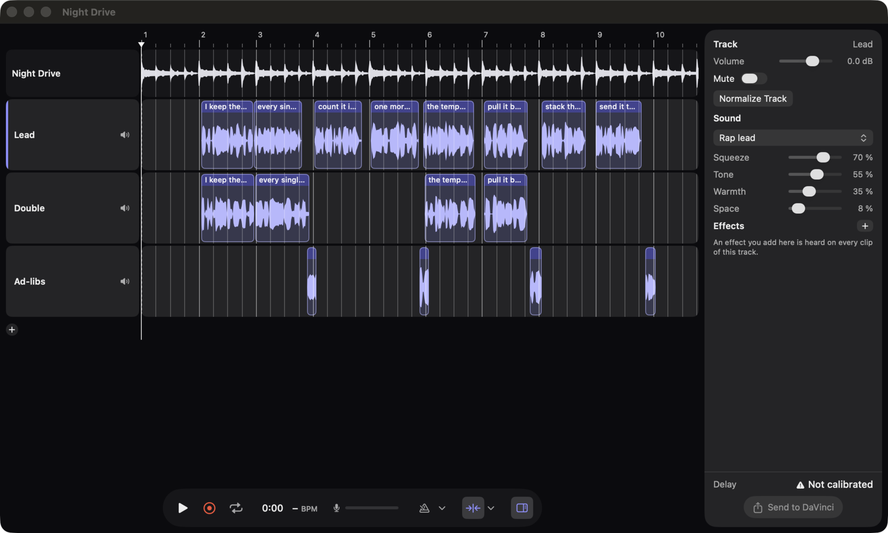
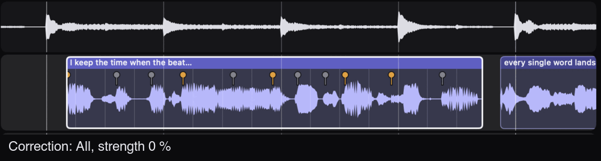
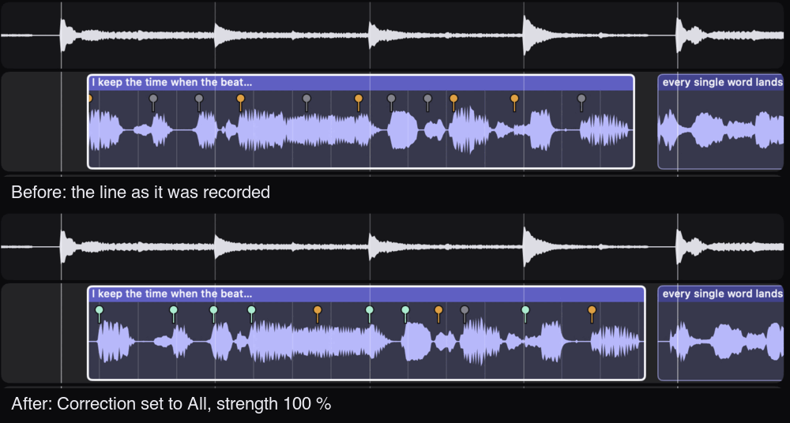
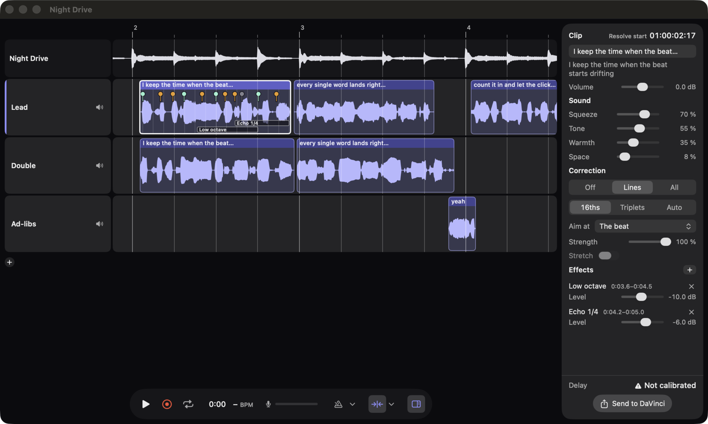
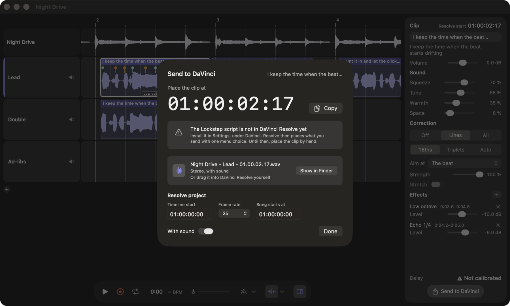

# Lockstep

Lockstep is a Mac app for recording rap vocals over a beat and getting every line onto that beat.
You drop in a song and record your lines against a click that follows the song's own tempo.
Lockstep then moves the lines, or every syllable, onto the beat, and sends the finished clips to
DaVinci Resolve at the right timecode.

**AI wrote all of the code in this repository.** A person directed the project and wrote no
code. AI coding agents wrote the code, the tests, the design and the documents. See [Built entirely by AI](#built-entirely-by-ai).



## The problem it solves

- **Beats that drift.** Beats made by AI music generators, and many beats made by hand, do not
  keep one exact tempo. A click at a fixed tempo slowly walks away from the song, so you end up
  rapping against something that is no longer the beat.
- **Lines that miss.** A line that starts a little late, or syllables that rush, sound loose.
  Moving them by hand in an editor is slow.
- **A mixer that can't be scripted from outside.** The free edition of DaVinci Resolve does not
  let another program control it, so getting each vocal clip to the right place in the timeline
  is manual work.

## What it does

- **Finds every beat** of the song with a neural beat tracker ("Beat This!"), following the tempo
  as it drifts, and numbers the bars.
- **A click that follows the song**, beat by beat, with a count-in. It can also be written out
  as a click file.
- **Takes and lines.** Record on any number of tracks. Recording again over the same line makes
  a new take of it, and you can step through the takes. You can move, cut, join, copy and mute
  clips, and undo every edit.
- **Words on clips.** Each clip shows the words you rapped, written out on the Mac by
  whisper.cpp.
- **Correction** for each clip, under "Correction" in the panel on the right:
  - **Lines** slides the whole line so that its first syllable lands on the nearest sixteenth
    (or triplet).
  - **All** also moves each syllable inside the line towards the grid.
  - **Strength** sets how far they move, from 0 to 100 %.
  - **Stretch** lets the correction stretch and squeeze your voice (with the Rubber Band
    library) to move syllables that run together. Off, your voice is only shifted, never
    stretched.

  Correction never changes the recording itself. Lockstep applies it when the clip is played or
  sent.
- **Locked doubles.** A double can aim at the lead track instead of the beat, so each of its
  syllables is pulled onto its partner in the lead. With Stretch on, held notes end together too.
- **Sound.** Six presets for a track (Rap lead, Rap double, Ad-lib, Sung lead, Sung hook,
  Backing voice) with four knobs: Squeeze, Tone, Warmth and Space. Effects go on a whole track,
  a whole clip, or a few marked words: six doubles (Thick, a fourth down, an octave down, High,
  Big, Small), two echoes timed to the beat, a phone voice, a stutter, a tape stop and a swell.
- **Record slower.** Record at 90 % or 85 % of the song's speed when a part is too fast to
  rap cleanly. Lockstep speeds the take back up to the song's tempo afterwards.
- **Delay calibration.** Measures how late your headphones and microphone are, so takes land
  where you heard them.
- **Send to DaVinci.** Exports each clip as a WAV file (48 kHz, 24-bit) with its correction and
  sound applied, and tells you the timecode where it goes. A small Lua script installed in
  DaVinci Resolve then places the sent clips on their tracks at their timecodes with one menu
  choice, also in the free edition.

The animation below shows one line with "All" correction going from 0 % to 100 %. The pins are the
syllables Lockstep found. Green means a syllable is on the grid, orange that it is slightly off,
and grey that it is far enough off to count as on purpose, so it is left alone.





A selected clip shows its own Sound knobs, correction and effects in the panel on the right. Here
the first line has a low octave double on a few words and a quarter-note echo on its last words:



Send to DaVinci writes the file and shows where it goes:



## Who it is for

People who record vocals over beats on a Mac and mix in DaVinci Resolve, above all rappers who
work alone over AI-made or other drifting beats. It was built for one person's way of working,
so some choices are personal. It is not a full audio workstation. There is no mixing desk and
no plug-in hosting, and only the vocals get sounds and effects.

## Requirements

- **A Mac with Apple silicon.** The project builds for `arm64` only.
- **macOS 26** (Tahoe) or later. The app and its packages target macOS 26.0.
- **Xcode 26.3** or later. The packages need Swift 6.2, which first came with Xcode 26, but
  only Xcode 26.3 has been used to build Lockstep.
- **[uv](https://docs.astral.sh/uv/)** for the script that makes the beat model. It fetches the
  Python packages it needs into its own cache and installs nothing on the system.
- **A network connection** for the first build (Swift Package Manager downloads the prebuilt
  whisper.cpp framework) and for the two model scripts.
- **A microphone and headphones** for recording.
- **DaVinci Resolve** only for Send to DaVinci. The script was written for the free edition of
  Resolve 21.0.4.

You need no Apple developer account. The build signs the app to run on the Mac that built it.

## Build and run

```sh
git clone <this repository>
cd Lockstep
xcodebuild -project Lockstep.xcodeproj -scheme Lockstep -configuration Debug -derivedDataPath build/DerivedData build
open build/DerivedData/Build/Products/Debug/Lockstep.app
```

Or open `Lockstep.xcodeproj` in Xcode and run the `Lockstep` scheme. Everything the build makes
goes into `build/`, which git ignores.

To sign with your own Apple team (macOS keeps the microphone permission per signature, so this
helps if you rebuild often), create `Config/Signing.local.xcconfig`, which git ignores:

```
DEVELOPMENT_TEAM = <your team id>
CODE_SIGN_IDENTITY = Apple Development
```

The `LockstepDesign` scheme builds Lockstep Design, a second app that shows every view of the
interface in every state, with made-up content. It needs no models and no microphone.

Run the tests with:

```sh
xcodebuild test -project Lockstep.xcodeproj -scheme Lockstep -derivedDataPath build/DerivedData
```

Three tests load the real speech models. They run only when both models are installed and
`LOCKSTEP_SPEECH=1` reaches them. `xcodebuild` passes a variable on to the tests only with the
`TEST_RUNNER_` prefix:

```sh
TEST_RUNNER_LOCKSTEP_SPEECH=1 xcodebuild test -project Lockstep.xcodeproj -scheme Lockstep -derivedDataPath build/DerivedData
```

## The models

Neither model is in this repository. Each script downloads its model, checks its checksum and
installs it under `~/Library/Application Support/Lockstep/Models/`, outside the repository.

- **Beat model.** Lockstep needs it to find beats.

  ```sh
  Scripts/install-beat-model.sh
  ```

  Downloads the "Beat This!" checkpoint (81 MB), converts it to Core ML with `uv`, and installs
  `BeatThis.mlpackage`.

- **Speech models.** These are optional. Without them, clips have no words.

  ```sh
  Scripts/install-speech-model.sh               # both
  Scripts/install-speech-model.sh multilingual  # Whisper large-v3-turbo (q5_0), 574 MB, any language
  Scripts/install-speech-model.sh swedish       # KB-Whisper Small, 488 MB, Swedish
  ```

  Settings > Recording > "Language of the words" picks which one is used. A Mac whose first
  language is Swedish starts with the Swedish model; every other Mac starts with the
  multilingual one.

Both scripts take `--force` to download and install again.

## DaVinci Resolve setup

1. Open DaVinci Resolve once, so that it makes its own folders, and quit it.
2. In Lockstep, open Settings > DaVinci and press **Install**. This copies the script
   `Lockstep.lua` into Resolve's `Fusion/Scripts/Utility` folder.
3. Set the frame rate there to that of your Resolve timeline, and in the Send to DaVinci panel
   the timeline's start timecode and where the song starts on it.
4. Open Resolve again. The script is now under Workspace > Scripts > Lockstep.
5. Select clips in Lockstep and choose File > Send to DaVinci. Then, in Resolve, choose
   Workspace > Scripts > Lockstep. It imports the files into a bin called "Lockstep" and puts
   each clip on an audio track named like its Lockstep track, at its timecode. It never removes
   or moves anything that was already on the timeline.

Without the script you can drag the exported file in yourself and put it at the timecode the
panel shows.

Lockstep is made for Resolve 21.0.4. A later Resolve may stop running scripts in the free
edition.

## For developers and AI agents

[AGENTS.md](AGENTS.md) holds the project's rules and commands for whoever carries the code on,
person or AI agent. It also lists the launch arguments that let an agent drive the app without a
pointer. With them an agent can open a song, add takes from WAV files, choose correction, Sounds
and effects, send a clip, and measure how fast edits are. Each prints one line to standard error
saying what happened.

The look of every view, with a picture of each state, is in
[docs/design/design.md](docs/design/design.md).

## What is not finished

- **A track's Voice** (the recording made deeper, darker or lighter with Rubber Band) is built
  but switched off in the app. Its code is in place behind the feature set in
  `LockstepKit/Sources/LockstepCore/FeatureSet.swift`.
- **Words in languages other than Swedish** come from the multilingual model and have been
  tried far less than Swedish.
- **The DaVinci script** follows the scripting README of Resolve 21.0.4. The agents that wrote it
  could not run Resolve, so they only checked its syntax.
- Only one person has used Lockstep, on one Mac. Expect rough edges anywhere outside that path.

## Built entirely by AI

Lockstep is an AI project. Its owner decided what it should do, tried every phase in the app and
gave feedback, but wrote no code. AI coding agents wrote everything in this repository: the Swift
code, the tests, the Lua script, the shell and Python scripts, the design document and the
documentation, this README included.

- **Anthropic Claude** models wrote the code: Claude Fable 5.2 and Claude Opus 5.5.
- **OpenAI GPT-6 Astra** reviewed at least one plan before it was built.
- The agents worked from written plans, one phase at a time, kept with Folio, a tool that keeps
  plans, tasks and the reason for each change next to the code. That build log is not part of
  this repository.

What this means if you carry it on:

- Nobody has read every line the way the author of hand-written code would have. The code is
  tested where tests were asked for, and every phase was tried in the running app, but there was
  no line-by-line human review.
- Comments are plentiful and explain why, because the agents wrote them for the next agent. They
  are the best map of the code.
- [AGENTS.md](AGENTS.md) holds what an agent needs to carry on the same way, so you can hand
  the project to your own AI agent.

## Licence

Lockstep is free software under the [GNU General Public License, version 3 or later](LICENSE).

It builds in the Rubber Band Library, which is under the GPL (version 2 or later). That is why
Lockstep as a whole is under the GPL. Anyone who wants to distribute Lockstep, or a program made
from it, under other terms needs Breakfast Quay's commercial licence for Rubber Band first.

The other parts it uses (whisper.cpp, the Beat This! model, KB-Whisper and Whisper) and their
licences are listed in [THIRD-PARTY-NOTICES.md](THIRD-PARTY-NOTICES.md).
